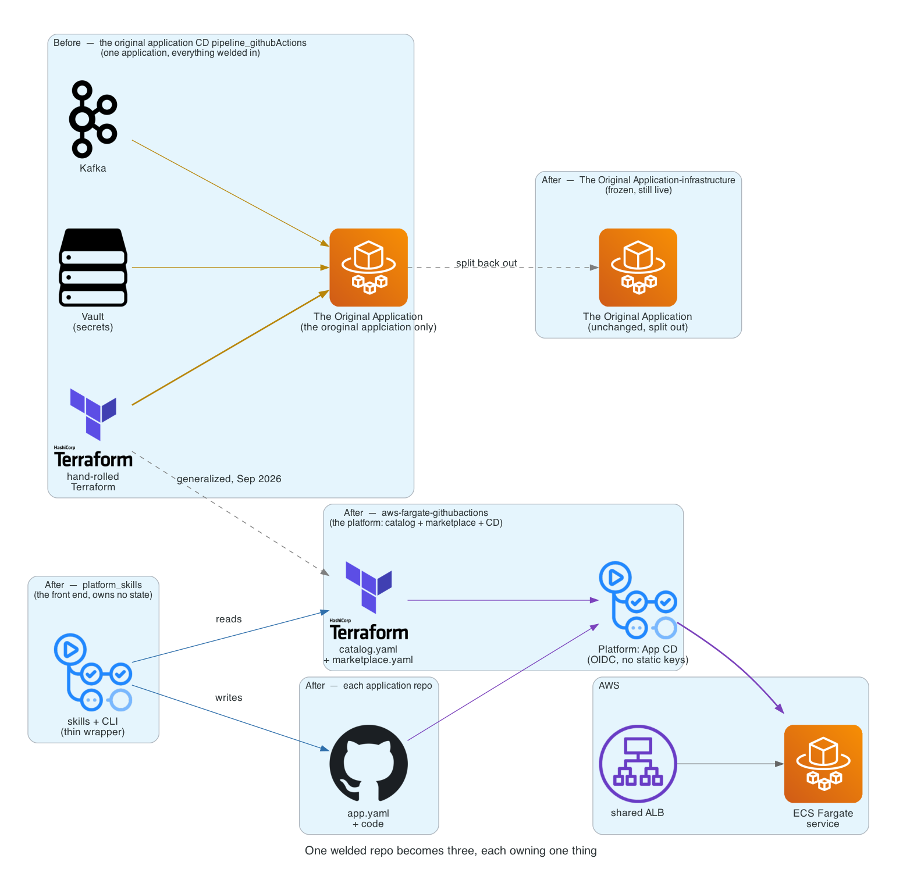

# Part 1 — One application's pipeline becomes a platform

*Series: Building the platform, from an existing CD pipeline to platform_skills.*

The goal was not "deploy a second application." The goal was to stop being
able to tell, from the shape of the code, that there had only ever been one.

That distinction matters because the repo we started from was never designed
to be generic. Our starting point was a single deployment pipeline —
GitHub Actions workflows, hand-rolled Terraform, Vault for secrets, a Kafka
cluster — all of it built, commit by commit, to get one 
application running and stay running.:

```
switching connection to database to public host instead of vpc host
adds database migration step to workflow
fix: remove apt lock retry logic to prevent user_data failures
save and retrieve app_droplet IP in vault
adds some kafka tool instructions
```

Every one of those fixes was correct, and every one of them was also a
sentence that could only be true about the original application.  The Vault paths assumed
one app. The Terraform roots were named `dev`, `test`, `prod` for one app.
The CD workflow built one Docker image for one ECR repository. There was no
seam anywhere you could cut to add a second application without copying the
whole thing and renaming it.

## The question that forced the split

The question wasn't "is this code good" — most of it was, after the usual
run of `fixing cd.yml` / `fixing cd.yml` commits that any CI pipeline
accumulates. The question was: **what happens to the next application?**

Answering it honestly meant admitting the repo was doing two jobs that had
gotten welded together:

1. **Being a reusable deployment platform** — modules, composition stacks, a
   build/deploy pipeline that doesn't know or care what application code it's building.
2. **Being Application specific deployment** — support a specific application's VPC CIDR, its Cognito
   pool, its three S3 buckets, its Kafka topics.

## What actually happened

The infrastructure code split into **modules** (leaf resources with no
application-specific content — `vpc`, `ecs-cluster`, `rds-postgres`, `msk`,
`cognito`) and **stacks** (the composition layers that assemble them per
application), with a `catalog.yaml` on top recording which repos this
platform can deploy and which AWS account each belongs to.

The *procedure* — the part that used to live in a README, a Slack thread,
and whoever had done it most recently — went somewhere new: a second repo,
`platform_skills`, written as a set of Claude Code Skills. Not a rewrite of
the platform, a front end over it: thin command wrappers over a CLI, which
is itself a thin wrapper over plain, testable functions. `platform-catalog`
answers "what exists and what's blocking it." `platform-deploy` stands up
infrastructure, populates secrets, and releases. `platform-adopt` brings a
new target on. None of them own state — they read the platform repo's
catalog and each application's own manifest, fresh, every time.

## The mistake this was built to prevent

Splitting the repo surfaced a risk that had been invisible while there was
only one AWS account to be in: **the default AWS CLI profile on a laptop
resolves to a specific AWS account, not the AWS Account targetted for the platform.** An `apply` aimed at
the wrong one doesn't fail loudly — it *succeeds*, quietly, against
somebody's running infrastructure.

So the account became something checked, not something remembered, at three
separate layers:

| Layer | What it does |
|---|---|
| `bootstrap.sh` | calls `sts:GetCallerIdentity` and refuses to run Terraform at all on a mismatch |
| The Terraform stack itself | a `precondition` block aborts the plan — needed because a local `apply` never goes through CI |
| The CD workflows | compare the assumed role's account to the application's manifest before building an image or touching ECS |

Three layers for one fact sounds like over-engineering until you notice they
guard three different paths into the same mistake: a human at a laptop, a
local `terraform apply`, and an automated workflow. Any one of them being the
only guard would have left the other two exposed.

## The Original Application didn't move — it got to stop carrying weight

The honest ending here is not "The Original Application joined the platform." It didn't.
Its three environments (`dev`/`test`/`prod`) are a different shape than the
platform's blue/green pair, its Cognito users and in-flight Kafka messages
don't survive the platform's cutover model, and none of that was worth
The Original Application' own Terraform roots, its ten legacy
CD workflows, its Kafka and Vault documentation — all of it moved, byte for
byte, into its own repo, `The Original Application-infrastructure`, marked plainly:
**frozen, still live.**

What came along and what deliberately didn't is worth naming, because "we
migrated it" undersells how much was left alone on purpose:

- The **5.4 GB of `.terraform/` provider caches** did not come across — they
  regenerate from `terraform init`, so copying them would have been copying
  nothing.
- **Git history did not come across either.** The new repo starts at a
  single commit. Recovering the history would need `git filter-repo`; worth
  doing only if someone actually wants to read it later, not worth doing on
  the way past.
- The **one Terraform state file that existed only on a laptop** — the
  bootstrap layer's own state, for the state bucket and OIDC provider The Original Application
  already depended on — got checked, not assumed: verified byte-identical
  after the copy, confirmed to be the only copy via `aws s3 ls`, and only
  then removed from the old location. The generic modules it depends on
  stayed in the platform repo, because nothing about `crunchy-bridge`, `msk`,
  or `cognito` was ever The Original Application-specific.

## Three repos, each owning one thing



That's the shape the platform settled into, and it's the shape the rest of
this series builds on: `platform_skills` is the front end and owns no state;
`aws-fargate-githubactions` is the platform and owns the catalog, the
Terraform, and the CD; each application repo owns its own manifest and code.
The Original Application, frozen off to the side, is proof the split didn't require
breaking anything to work.

## What's next

A platform that can deploy *an* application isn't yet a platform that knows
*which* applications it can deploy, or what any of them actually need from
it. Part 2 is the catalog and the marketplace that answer both — and the
broker that turns "this app wants a database" into a real one, without the
app ever naming which kind.
