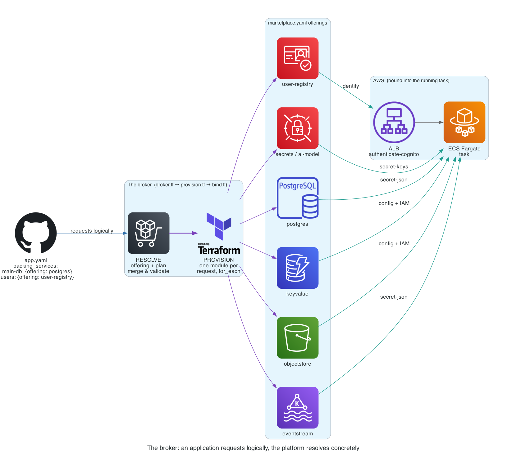

# Part 2 — A catalog, a marketplace, and a broker

*Series: Building the platform, from the original application CD pipeline to platform_skills.*

With the platform repo generalized and `platform_skills` wired up in front of
it, the next question was no longer architectural — it was concrete. **What,
exactly, can this thing deploy? And when it deploys one, what does that
application actually get?**

## Two catalogs, named explicitly because they kept getting conflated

The first catalog is `catalog.yaml` — the *DevOps Deployment Catalog*. It
answers "which repos can this platform build and deploy," and it is a file,
in git, available whether anything is running or not. Each entry names a
repo, the AWS account it belongs to, whether it deploys as a blue/green
`colored` pair or a stateful `singleton`, and a status: `active`,
`candidate`, `frozen`, or `excluded`.

```
Games (2)
  game1
  game2

Apps (3)
  account-planning
  research-assistant
  game-planner

Platform services (1) — what games and apps lean on
  subscription-service 
```

The second catalog is the *Application Runtime Subscription Catalog* — which
tenants, users, and entitlements exist. It lives in a database behind the
subscription service, and it only exists while that service is up.

Keeping them apart isn't a taxonomy exercise, it's a load-bearing rule: **a
deploy must never depend on a running service.** If deploying a fix to the
subscription service required the subscription service to already be
reachable, then the one scenario where you most need to deploy it — it's
down — is exactly the scenario where you couldn't.

`platform_skills` adds a third view, but deliberately not a third *store*: its
`catalog` command is a **projection**, the deployment catalog joined to each
application's own `app.yaml`, computed fresh on every read. Nothing here is
written down twice, because a second list that can drift from the first is,
in this platform's own words, worse than no list at all.

## Three hardcoded dependencies, and why they stopped being enough

Before the marketplace existed, an application declared `dependencies:
[database, kafka, auth]` and the platform wired up exactly those three
things, no more. It worked, right up until an application needed a second
database, or a cache that wasn't Kafka, or a bucket. The three dependencies
were a broker with the offerings welded directly into the code — which is
the same mistake Part 1 found one layer up, just recurring at the backing-
services layer instead of the application layer.

## The marketplace: request logically, resolve concretely

The fix generalizes the welded-in three into a marketplace. An application
requests services **logically** — an offering and a plan — and the platform
acts as broker: it resolves the request, provisions the instance, and binds
its credentials into the task that asked for it.

```yaml
# app.yaml
backing_services:
  main-db:
    offering: postgres
    plan: small
  sessions:
    offering: keyvalue
    plan: cache
  users:
    offering: user-registry
    plan: own-pool

services:
  api:
    bind: [main-db, sessions, users]
```

| Offering | Implementation | Binds as |
|---|---|---|
| `postgres` | RDS PostgreSQL | `DATABASE_URL` from a secret |
| `postgres-external` | bind-only, provisioned elsewhere | `DATABASE_URL` from a secret |
| `keyvalue` | DynamoDB table | `TABLE_NAME` + IAM, **no secret at all** |
| `objectstore` | S3 bucket | `<INSTANCE>_BUCKET` + IAM |
| `eventstream` | Amazon MSK | `KAFKA_*` from secrets |
| `user-registry` | Cognito pool (or the subscription service, planned) | ALB/Cognito wiring |
| `secrets` | a declared-key secrets store | one env var per key |
| `ai-model` | a vendor API key, or an IAM grant to Bedrock | `<VENDOR>_API_KEY` or nothing to leak |

## Why `keyvalue` means DynamoDB and not a Redis cluster

This is the worked example of what "resolve concretely" is actually buying.
app1's own code suggested it needed a cache — `redis>=5.0.0` in
`requirements.txt`, a `REDIS_URL` setting, its own `aws_elasticache_
replication_group`. A repo-wide search found **no Redis client usage at
all** — the cluster was running, idle, and costing money.

Settling what `keyvalue` *means* happened once, for the whole platform, by
comparing what the two real candidates are actually good at:

| | DynamoDB | ElastiCache |
|---|---|---|
| Pub/sub, queues, sorted sets | ❌ | ✅ |
| Cost when idle | **$0**, on-demand | a node runs 24/7 whether used or not |
| VPC footprint | none — a free gateway endpoint | subnet group + security group |

Given this platform's posture — single-region, services defaulting to
`desired_count: 0`, two colors existing in parallel — an always-on cache node
per color for a service that may scale to zero is close to pure waste. So
`keyvalue` resolves to DynamoDB today. The application never wrote "DynamoDB"
anywhere; it wrote `offering: keyvalue`, and the platform's judgment, made
once, is what it got.

## The broker, in three stages



**RESOLVE** matches each request to an offering and plan, merges `offering
options < plan < request` so one value can be tuned without inventing a new
plan, and validates: an unknown offering or plan fails the *plan*, by name,
before anything is provisioned. **PROVISION** instantiates the implementing
module once per request. **BIND** turns outputs into what a task actually
needs — an ECS secret injection, a plain config value, an IAM statement — and
containers opt in explicitly with `bind: [...]`, so provisioning a database
does not silently hand its credentials to every container in the app.

Two instances resolving to the same environment variable name **fails the
plan outright** rather than merging — the loser would otherwise be silently
unreachable, and a second database needs an explicit `env:` instead of a
collision nobody notices until runtime.

The broker also runs as a **pre-flight** in CI, before any image builds. An
unresolvable service request dooms the deploy no matter how good the image
is, so the `resolve` job fails fast with `::error::` annotations and writes
the resolved instance table to the run's summary — failing before the build
is both faster and a better place to read the error.

## What actually went up

app1 is the platform's first real proof point, deployed end to end on
`prod-blue`: both services healthy behind the shared ALB, Cognito
registration working, Alembic migrations running as a `lifecycle.release`
task. That exercised bootstrap, the broker (`postgres` and `user-registry`),
build, deploy, rollback, and scale-to-zero — all for real, not in a plan
file.

What it didn't exercise is just as useful to name: `keyvalue`, `objectstore`,
and `eventstream` are implemented but unproven against a real workload. A
second AWS account is registered but untouched. Blue/green cutover — the
weighted Route 53 flip — is unproven because only `prod-blue` exists so far.
Terraform has never run from CI; every apply so far has gone through
`bootstrap.sh` on a laptop, with the same account guard from Part 1 standing
in front of it either way.

## What's next

The marketplace answers "what does an application get." It doesn't yet
answer the question every *new* application actually arrives asking: **what
do I do with the deployment pipeline this application already has?** Six
applications showed up already running on Fargate, deployed by AWS Copilot.
Part 3 is retiring that — on purpose, with the collisions named up front
instead of discovered during a cutover.
