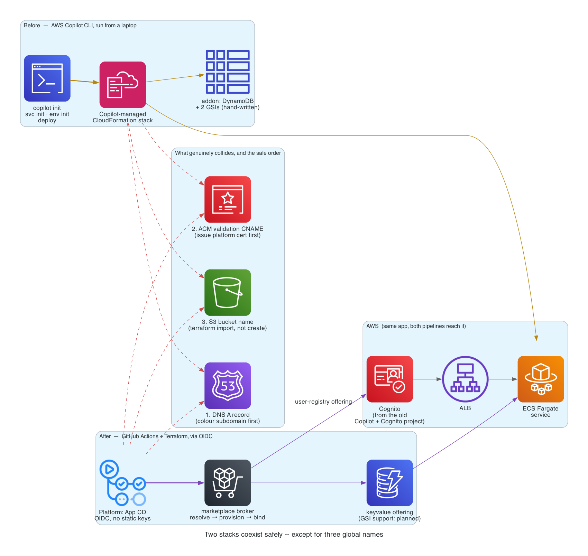

# Part 3 — Retiring AWS Copilot

*Series: Building the platform, from the original application CD pipeline to platform_skills.*

Every application invited onto the platform arrived carrying its own working
deployment. Not a broken one — a *working* one, which is the harder case.
Six small single-container services were already running on Fargate, each
deployed by typing `copilot init`, `copilot svc init`, `copilot env init`,
and `copilot deploy` from a laptop. One of them — `account-planning` — was
the very app this series' original walkthrough documented: a Gradio chatbot,
deployed with

```
copilot init                                   \
  --app          planning                      \
  --name         planning                      \
  --type         'Load Balanced Web Service'    \
  --dockerfile   './Dockerfile'                 \
  --port         7860                           \
  --tag          '1.0.0'
```

and it worked — Copilot provisions real, solid CloudFormation. The question
was never whether Copilot could run a container on Fargate. It was what
happens once there's a platform that has to run *all* of them, uniformly,
from CI, without six different hand-remembered procedures.

## Adoption is mostly deletion

`platform-adopt`, the skill that brings a new target onto the platform, says
this plainly: **"adoption is mostly deletion."** Every candidate arrives
reinventing the platform in miniature — a `copilot/` directory, sometimes an
`infrastructure/terraform/` tree, its own CI. What replaces all of it is one
`app.yaml` and two small Terraform roots. The measurable win is less
infrastructure code under maintenance, not more of it.

The rule that makes this safe rather than reckless is the first thing the
skill insists on: **read the target's existing deployment config first.**
The Copilot manifest, the old Terraform, the Dockerfile and CI workflow are
*authoritative* for how the thing actually builds and runs — derived from
them, never guessed. A port number or a health-check path is exactly the
kind of fact that's cheap to get wrong by assumption and expensive to debug
once it's wrong in production.

## The gap that got written down instead of faked

Migrating the subscription service surfaced a real one. Its earlier
deployment used a **Copilot addon** — Copilot's own escape hatch, a
hand-written CloudFormation template bundled alongside the manifest for
anything outside Copilot's abstractions — to attach **two Global Secondary
Indexes** to a DynamoDB table.

The platform's own `modules/dynamodb-table` doesn't support GSIs yet. The
honest options were port the addon's CloudFormation by hand (reintroducing
exactly the kind of bespoke, unowned infrastructure the platform exists to
eliminate), fake a workaround, or name the gap and block on it. The
marketplace's own `status`/`blockers` convention — already used for
`shared-subscriptions`, see Part 2 — made the third option the easy one:
`keyvalue` stays available for workloads that don't need a GSI, and the
subscription service's own persistence work is recorded as blocked on GSI
support closing, not silently worked around.

## Cognito didn't get reinvented — it got generalized

The identity side has a cleaner ending. An earlier project, [Secure AWS
Fargate Deployment with Copilot and
Cognito](/field-notes/aws-copilot-fargate-cognito/), wired Amazon Cognito
into a Copilot-deployed service by hand: a user pool, an app client, an ALB
listener rule doing the OAuth dance. That exact pattern — the ALB performing
`authenticate-cognito` before a request ever reaches the container — is now
the platform's `user-registry` marketplace offering. An application asks for
it in four lines:

```yaml
backing_services:
  users:
    offering: user-registry
    plan: own-pool
```

and gets the same ALB-level authentication, the same pool-per-environment
isolation, with no listener rule hand-written anywhere in the application
repo. The functionality didn't get thrown away when Copilot did — it moved
from something you wired once, by hand, into something the broker resolves
the same way for every application that asks.

## Why the CLI itself had to go, not just get wrapped

Porting the functionality wasn't really the point — it was possible to do
that and still leave the mechanism imperative. The reason Copilot was retired
as a *mechanism*, not kept and scripted around, comes down to where the
knowledge of what happened lives:

| | AWS Copilot CLI | The platform |
|---|---|---|
| Run from | whoever's laptop, whenever they remember to | GitHub Actions, OIDC-assumed role, no static keys |
| What ran last | implied by CloudFormation drift | `catalog.yaml` + the dispatched workflow run |
| Validity check | discovered at `deploy` time | a broker pre-flight that fails before any image builds |
| Safe to retry | depends on where the last run stopped | idempotent by construction — a deploy creates with `desired_count: 0`, running is a separate decision |

Copilot's CLI model concentrates operational knowledge in a person's muscle
memory. The platform's model concentrates it in a file that CI reads the same
way every time. That's the actual justification for retiring the tool rather
than writing a wrapper around it.

## The part that keeps this safe: two stacks, same app, on purpose



Retiring a working pipeline is only safe if the replacement can exist
*alongside* it for a while, and it can, **by construction**: a platform
deploy creates new infrastructure under new names — a new VPC, a new
cluster, new ECR repos, a new database. It doesn't adopt or modify anything
the Copilot stack manages. Nothing is destroyed by standing the new one up.
What it costs instead is money — you pay for both stacks for as long as both
exist.

Only three things are **global or unique namespaces**, and they're exactly
the places two independently-created stacks can genuinely collide:

1. **DNS.** A plain A record already owning the name the platform wants to
   serve blocks Route 53 from accepting a weighted record of the same name
   and type. Verify on the colour subdomain first; only introduce the live
   record once the legacy one is gone.
2. **ACM validation.** Two certificates covering the same name produce the
   same validation CNAME, and the second `apply` fails on it. Issue the
   platform's certificate for the colour domain *before* removing the old
   one.
3. **Globally-unique names** — S3 buckets, mainly, or anything the legacy
   stack created by hand. These need `terraform import`, never `create`.

## Where to actually start

Not with the hardest application. **Start with a Copilot app, not app1**
— the six small Copilot services prove the platform end-to-end (bootstrap,
broker, build, deploy, rollback) without first needing the cache contract or
the subscription service's persistence work. Harder migrations get easier
once the mechanism itself is already trusted.

## Closing the arc

The original application CD pipeline became a platform that knows it owns no state (Part
1). The platform grew a catalog of what it can deploy and a marketplace of
what it can provision, with a broker that resolves a logical request into a
concrete resource without the application ever naming which one (Part 2).
And the tool that got every one of these applications onto Fargate in the
first place got retired deliberately — its real functionality carried
forward through the marketplace, its remaining gaps written down instead of
quietly worked around, and the three places two stacks can actually collide
named before a cutover ever needs them (Part 3).

The constant across all three days, if there is one: a fact worth trusting
lives in exactly one place — a file, a catalog entry, a resolved plan — never
in whoever happened to run the command last.
