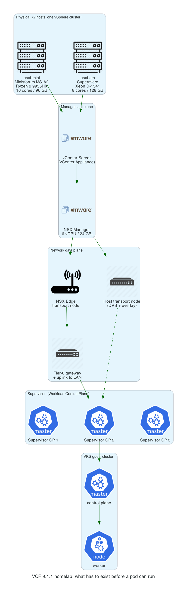
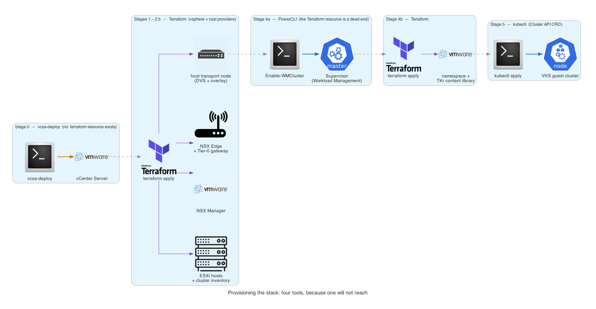

# Part 1 — Four tools, one skill

*Series: Homelab Automation Skills.*



The goal was not "build a homelab." I have built homelabs. The goal was to write a
**skill** — an artifact an automation system executes, rather than a document a person
follows — that could build this one, and then rebuild it from bare metal without me
remembering anything.

That target matters, because it sets the bar. The skill has to be good enough to hand
to a harness, a configuration-management run, or an agent, and have the build come out
right with nobody standing over it. Anything the reader is expected to already know is
a defect.

That distinction turns out to matter more than it sounds like it should. A runbook
you write for yourself can be wrong in a hundred small ways and still work, because
you are standing next to it filling in the gaps. A skill cannot. A skill is read by
something with no memory of the last three hours of your debugging. Everything you
knew but did not write down is simply gone.

So this series is not really a VCF/VKS install guide. It is a log of what happened when
I tried to write down operational knowledge precisely enough that a machine could act
on it — and kept discovering that the things worth writing down were not the things
I expected.

This part covers the first discovery, which arrived before a single resource was
provisioned: **no one tool reaches the whole stack, and the ways they fall short are
not all the same kind of problem.**

> **If you don't do this for a living.** Building this environment is like
> assembling a machine where each layer has to be installed and switched on before
> the next one can even be measured. "Automation" here means writing instructions
> precise enough that software can do it unattended. This post is about four
> different ways those instructions can be wrong — and why only one of them looks
> like an error at the time.

---

## What we were building

The target is VMware Cloud Foundation 9.1.1 running vSphere Kubernetes Service, on
two hosts in a single vSphere cluster:

- **esxi-mini** — a Minisforum MS-A2: Ryzen 9 9955HX, 16 cores, 96 GB of RAM
- **esxi-sm** — an older Supermicro: Xeon D-1541, 8 cores, 128 GB of RAM

Both modest, deliberately, because constraints are where the interesting failures
live. One is AMD and one is Intel, which means cluster-level EVC is off and live
migration between them is impossible — a detail that looks like trivia here and
turns out to decide things several parts from now.

Here is what has to exist, bottom to top, before one Kubernetes pod can be scheduled:



Every layer depends on everything beneath it, and several of those dependencies are
not merely "A should come before B" — they are "B's tooling cannot even be configured
until A is answering API calls." That is the whole reason this build is staged rather
than a single `apply`, and it is the first thing the skill has to explain.

## The assumption

The repo this grew out of already had Terraform in it. The natural plan, the one I
would have written down without thinking hard, was:

> Terraform the whole thing. One root module, a handful of child modules, `terraform
> apply`, go get coffee.

That assumption survived about a day.

## Four kinds of gap, not four bugs

It broke four different ways, and the useful discovery was not the individual breakages. It was that
they are four **different categories of problem**, each wanting a different response.
Treating them as one undifferentiated pile of gotchas is what makes a document long
and useless.

| # | Category | What it feels like | Instance |
|---|---|---|---|
| 1 | The tool cannot reach here | You search the docs for a feature that was never written | Stage 0, vCenter |
| 2 | The tool fails in a misleading way | The error blames the wrong thing, confidently | Stages 1–2.5, NSX Manager |
| 3 | The tool appears to work and does not | Everything previews perfectly, then doesn't work | Stage 4a, Supervisor |
| 4 | The boundary is a different system | Your credentials stop meaning anything | Stage 5, guest cluster |

The rest of this post is one section per category.

---

## 1. The tool cannot reach here

**Stage 0 — there is nothing to Terraform.**

vCenter has no Terraform resource. Not a buggy one, not a deprecated one — none. The
`vsphere` provider is a *client* of vCenter; it cannot bootstrap the thing it
authenticates against. The dependency is circular by construction.

It is also not a simple OVA push. vCenter installs in two phases: deploy the appliance,
then make a separate setup-wizard API call to configure SSO and the Platform Services
Controller. NSX Manager, by contrast, really is one OVA plus some vApp properties —
which is exactly why NSX Manager *is* Terraformed in this repo and vCenter is not.

So Stage 0 is VMware's own `vcsa-deploy` CLI, wrapped in a shell script, run before
Terraform is allowed to exist. From the script's header:

```
# Deploys vCenter directly onto a bare ESXi host using VMware's vcsa-deploy
# CLI, before anything else in this repo can run. The vsphere Terraform
# provider needs a vCenter to connect to, and vCenter's own install is a
# two-phase process (OVA deploy, then a separate SSO/PSC setup-wizard API
# call) that Terraform's vsphere provider has no resource for.
```

That comment is in the script because it is the kind of thing that is obvious for
about a week and then isn't.

> **In plain terms.** The main automation tool works by logging in to the management
> system and telling it what to do. So it cannot be used to *create* that management
> system — there is nobody to log in to yet. It is the locksmith whose van key is
> locked inside the house.
>
> This category is the cheapest to handle and the easiest to waste time on. There is
> no clever workaround to find, because nothing is broken. The only cost is the hours
> spent searching for a capability that was never built. **Writing down "this does
> not exist, stop looking" is itself worth real time.**

## 2. The tool fails in a misleading way

**Stages 1–2.5 — Terraform, but it connects too early.**

These stages *are* Terraform: the ESXi host and cluster inventory, NSX Manager, the
NSX Edge and Tier-0 gateway, host transport node preparation. This is the broad middle
where Terraform genuinely earns its place.

But they still had to be split into separate applies, for a reason that has nothing
to do with VMware:

**The `nsxt` provider connects eagerly at configure time.** If NSX Manager does not
exist yet, `terraform plan` does not fail for the NSX resources — it fails for the
*entire root module*. Every resource, including the ones that would have built NSX
Manager in the first place. There is no lazy-connect option on that provider.

The workaround in this repo is not elegant, and I am not going to pretend otherwise.
`stage.sh` comments out the provider block with `sed`:

```bash
comment_nsxt_provider() {
    sed -i.tmp '/^provider "nsxt" {/,/^}/ s/^/# /' "${MAIN_TF}"
    ...
}
```

A script that edits your Terraform source before running it is a smell. It is also,
as far as I can tell, the only thing that works. Worth noting: the `kubectl` provider
used later has a `lazy_load = true` option for precisely this problem, which is why
Stage 5 needs no such surgery. The capability exists in the ecosystem. The `nsxt`
provider just doesn't have it.

> **In plain terms.** Imagine a spell-checker that refuses to open your document
> because one word is missing from its dictionary — and reports the problem as "this
> document is invalid." You would start rewriting the document. The document is fine.
> The dictionary just hasn't loaded yet.
>
> This category is expensive because **the error sends you to the wrong place and
> sounds authoritative while doing it.** You can lose a day improving something that
> was never wrong. The fix for the skill is not the workaround — it is recording what
> the misleading message actually means, so the next reader skips the detour entirely.

## 3. The tool appears to work and does not

**Stage 4a — the resource exists, and it is a dead end.**

This is the one that actually cost time, because here Terraform *looks* like it works.

`vsphere_supervisor_v2` is a real resource in the pinned provider. It takes the CIDR
ranges Supervisor needs. It plans cleanly. And it could not enable Workload Management
in this environment, for reasons that only became visible after reading the provider's
Go source rather than its documentation.

The instinct at that point is to keep patching — try a different networking model, try
a different load balancer option, work around the bug. I spent real hours doing that.
Classic NSX networking turned out to accept only the NSX Edge load balancer
(`"NSX edge is the only provider supported for NSX networks"`, straight out of vCenter's
own API), which funnels directly back into the provider bug the detour was trying to
avoid.

The question I should have asked sooner was not *how do I work around this provider?*
but **is Terraform the right tool for this one step at all?**

It wasn't. PowerCLI's `Enable-WMCluster` — VMware's own first-party automation —
exposes `ServiceCIDR`, `PodCIDRs`, `ExternalIngressCIDRs` and `ExternalEgressCIDRs`
as plain, correctly-wired parameters. It sidesteps both provider bugs by not being
the buggy code path.

I want to be honest about the price. Switching tools here also forced an architecture
change — walking back from NSX VPC networking to classic networking, which requires
NSX *host* preparation, not just Edge preparation. The fix for "this provider is buggy"
was "use a different tool for this step **and** change the underlying design." That is
not a small patch, and a skill that presents it as one would be lying.

> **In plain terms.** The tool offers a preview — a dress rehearsal that shows exactly
> what it is about to change. The rehearsal is flawless. Opening night fails anyway,
> because the preview checks whether the *request* is well-formed, not whether the
> system will accept it.
>
> This is the most dangerous category, for a reason worth sitting with: **you trust
> the preview, because trusting the preview is the entire point of having one.** And
> the trap is sunk cost. Every hour spent working around the problem makes abandoning
> the tool feel more wasteful, right up until you realise the question was never "how
> do I fix this?" but "should I be using this at all?"

## 4. The boundary is a different system

**Stage 5 — not a vSphere object at all.**

The guest Kubernetes cluster is a Cluster API custom resource. It is created by
`kubectl apply` against the Supervisor's own Kubernetes API, using a ClusterClass that
Supervisor publishes. vSphere's provider is not in the picture, and neither is vCenter's
API. You have authenticated to a different control plane entirely.

> **In plain terms.** You have spent all day negotiating with the building manager.
> Partway up, without any sign on the door, you are now dealing with the city. New
> authority, new paperwork, new credentials — and the badge that opened every door
> below means nothing here.
>
> This category is not a defect at all; it is a border. It only hurts when nobody
> tells you it is there, because every habit you built on one side quietly stops
> applying on the other. **A skill that marks the border is doing something a list of
> steps cannot**: a sequence of instructions reads as one continuous activity, which
> is exactly the wrong mental model.

---

## Four tools, because one will not reach



Terraform does the broad middle and does it well. But the bottom of the stack is an
imperative CLI, one stage near the top is PowerShell, and the summit is Kubernetes'
own API. The transitions between them are not incidental — they are where almost
every hard failure in this project turned out to live.

## The first rule

Here is what I actually learned, and it is not about VMware.

When I started, I thought the valuable content of a skill was the **procedure** —
the ordered list of what to do. Run this, then that, with these values.

The procedure is the cheap half. It is reconstructible from the code, and it goes
stale the moment a provider version bumps. What is *not* reconstructible, and what
costs days to rediscover, is the shape of the gaps — and the four categories above
are that shape:

- **This tool cannot reach here.** No vCenter resource exists. Stop looking for one.
- **This tool fails in a misleading way.** The `nsxt` provider's failure blames your
  whole configuration, not the missing appliance.
- **This tool appears to work and does not.** `vsphere_supervisor_v2` plans beautifully.
- **This boundary is a different system.** Stage 5 is not vSphere at all.

A skill that only lists steps will walk an agent — or a person — straight into every
one of those, confidently. A skill that names them turns a multi-day investigation into
a paragraph.

So the first rule that went into `SKILL.md` was not a procedure. It was a section
explaining why the deployment is staged at all, what each tool can and cannot do, and
which boundaries are real:

> Stages 1–5 are the actual Terraform flow. Staging those exists because the `nsxt`
> provider **connects eagerly at configure time** — if NSX Manager doesn't exist yet,
> `terraform plan` fails outright for the whole root module, not just the resources
> that need it.

That paragraph is worth more than the rest of the file.

> **In plain terms.** The instructions everyone writes down are the steps. The steps
> are the part you could have worked out again from the finished product. What you
> cannot reconstruct — and what actually costs the days — is the map of where the
> tools run out, lie, bluff, or hand you to someone else. That map is the thing worth
> writing down, and almost nobody does, because by the time you have it the work feels
> finished.

---

## What's next

Part 1 is the easy lesson, in the sense that it was learned before anything was at
risk. Nothing had been built yet, so nothing could be lost. The rest of the series is
less tidy, and the categories get worse: from *the tool told me something untrue* to
*the tool told me nothing at all.*

Coming up: what happens when the API says `200 OK` and nothing was created; a
deployment that destroyed more than it built and how the plan output said so in a way
I nearly missed; a host I bricked by acting on a theory I had not tested; and the point
where the real constraint on the lab turned out not to be CPU, RAM, or any provider at
all, but temperature.

The thread running through all of it, which I did not see until about Part 4:
**check the object, not the exit code.**
